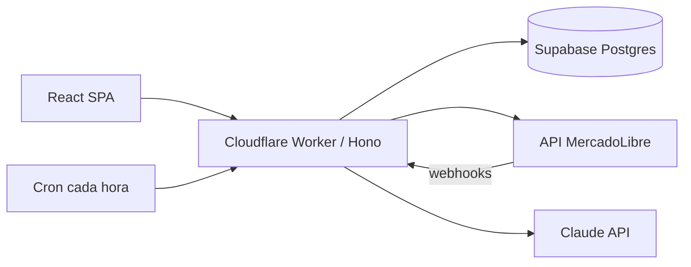

# Indiggo Panel

Panel de administración privado para una tienda de MercadoLibre: publicaciones con borradores de IA y revisión humana, catálogo, stock, producción, pedidos, preguntas y métricas.

## Qué problema resuelve

Indiggo Store es un negocio unipersonal que vende merchandising K-pop impreso en 3D en MercadoLibre Argentina. Crear y mantener publicaciones, controlar el stock de piezas compartidas, planificar qué imprimir y responder preguntas a mano llevaba demasiado tiempo. Este panel automatiza esas tareas con IA, pero nada se publica en MercadoLibre sin que una persona lo revise. Resultado confirmado: se redujo un 90% el tiempo para crear cada publicación.

## Funcionalidades

- Publicaciones: lista real de MercadoLibre, borradores con IA (título y descripción), creación en pausa y edición masiva de precios.
- Inventario: productos terminados, reservas, piezas compartidas, recetas editables y movimientos trazables.
- Producción: registro de impresiones y armados sugeridos, sin asignar una pieza dos veces.
- Pedidos: sincronización con MercadoLibre, reserva y descuento de stock una sola vez por despacho, cálculo de neto.
- Preguntas y mensajes: historial, respuesta sugerida con fuentes, revisión del vendedor y avisos Web Push.
- Métricas: ventas, cobertura, faltantes y proporción de respuestas automáticas.
- Contenido para redes: imagen o video más caption y hashtags generados con IA.
- Integración con Google Sheets (planilla de reparto) y alertas automáticas.

## Stack

| Capa | Tecnología |
|---|---|
| Frontend | React 19, Vite 6, React Router 7, Tailwind v4 |
| Backend | Cloudflare Worker (Hono) con Cron Triggers, SPA servido con Workers Static Assets |
| Base de datos | Supabase (Postgres), migraciones SQL versionadas |
| IA | Claude API (texto), kie.ai (imagen y video) |
| Integraciones | API y OAuth de MercadoLibre, Google Sheets, Web Push |
| Tests | vitest |

## Arquitectura

Un único Worker sirve el SPA y la API JSON (`/api/*`). Un cron renueva el token de MercadoLibre y sincroniza publicaciones, variantes y pedidos cada hora; además, MercadoLibre notifica cambios por webhook. El stock físico y el publicado se mantienen separados.



## Cómo correrlo localmente

```bash
npm install
cp .env.example .dev.vars   # completá tus propias claves
npm run dev                 # http://localhost:5173 (SPA + Worker + cron)
```

Las variables necesarias están listadas en `.env.example`. Las migraciones de `supabase/migrations` se aplican en orden sobre tu proyecto de Supabase. Para desplegar: `npm run deploy` (requiere cuenta de Cloudflare y los secretos cargados con `wrangler secret`).

## Tests

```bash
npm test
```

Con vitest se cubren las reglas que no deben romperse: una pieza compartida nunca se cuenta dos veces, el colchón comercial se mantiene separado del stock físico, los movimientos son idempotentes, un pedido ya despachado no vuelve a reservar stock, además de preguntas, mensajes, envíos, neto y el contrato de las migraciones.

## Estado del proyecto

Desplegado en Cloudflare Workers y usado por una sola persona para operar la tienda real. Es un panel privado de un solo usuario: la autenticación se resuelve con una clave del panel y Cloudflare Access sobre el deploy. Los datos y credenciales de la tienda no están en este repositorio.

## Qué aprendí

- Modelar inventario con piezas compartidas y reservas transaccionales en Postgres, con tests que fijan las reglas críticas.
- Integrar OAuth, webhooks y sincronización periódica con la API de MercadoLibre.
- Diseñar flujos de IA con revisión humana antes de cualquier acción irreversible, tratando el texto de compradores como contenido no confiable.
- Trabajar con un flujo asistido por IA: el repo incluye `CLAUDE.md` y `AGENTS.md` con las guías para los agentes de código.

## English summary

Indiggo Panel is a private admin panel for a one-person MercadoLibre store that sells 3D-printed K-pop merchandise in Argentina. It uses AI to draft product listings, but a human reviews everything before it is published. It also handles catalog, stock and production planning, orders, buyer questions and metrics. It is built with React, a Cloudflare Worker (Hono) with cron jobs, Supabase Postgres, the Claude API and the MercadoLibre API. It cut the time to create each listing by 90%. It is deployed and used by one person, and it has vitest tests for the critical inventory rules.
